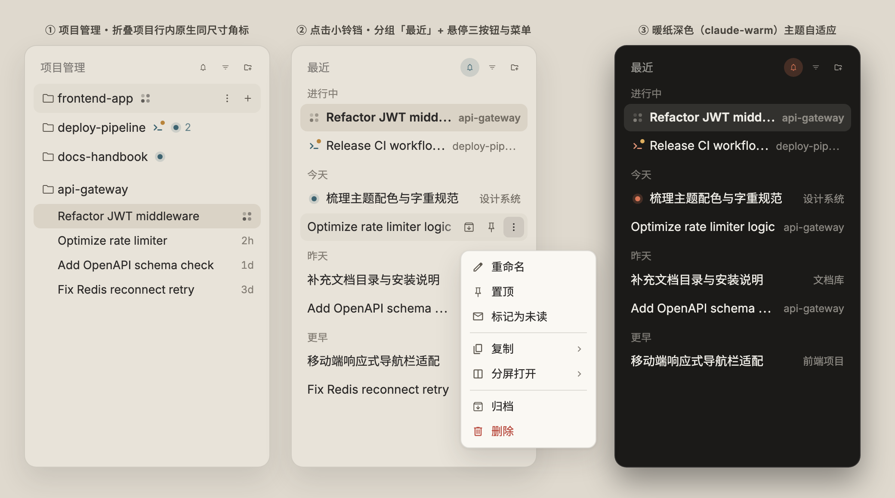
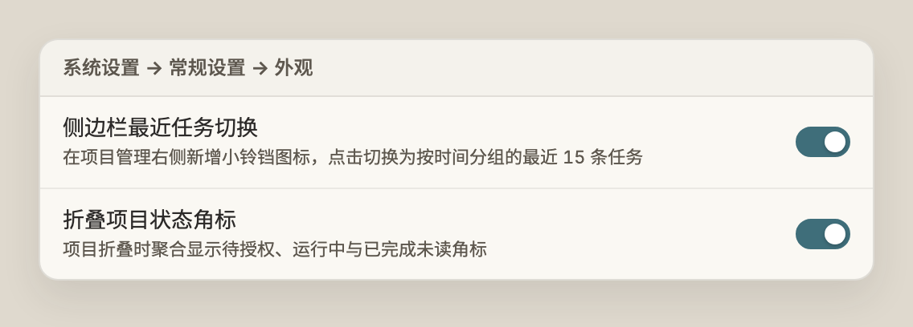

# Antigravity Sidebar Enhance

[](./LICENSE)
[](https://github.com/Anarcadia/chuanban-antigravity-theme-patch)
[](#技术实现与安全边界)

面向 [chuanban-antigravity-theme-patch](https://github.com/Anarcadia/chuanban-antigravity-theme-patch) 的 **零改包 `user/` 层侧边栏效率增强组件**。

无需修改 `app.asar`、无需重新签名、无需额外后台进程；直接挂载在船板主题补丁的 `user/custom.js` 与 `user/custom.css` 独立标记块中，与 [ghang-antigravity-local-ui](https://github.com/ghang/ghang-antigravity-local-ui) 等用户层组件天然共存、互不覆盖，升级船板主题内核时自动保留。

<p align="center">
  
</p>

## 核心功能

### 1. 「项目管理」原位切换为时间分组「最近（15 条）」
- **零额外占高入口**：在侧边栏「项目管理」标题右侧两个原生图标旁新增同风格小铃铛按钮，不新增第二滚动区，不挤压项目列表。
- **时间分组 + 响应式项目名**：点击小铃铛后，整个列表原位切换为按 **进行中 / 今天 / 昨天 / 更早** 分组的单行「最近」视图（默认展示最新 15 条）；常态左侧显示对话标题，右侧展示所属项目名，采用 `clamp(52px, 32%, 108px)` 弹性上限——短项目名（如 2–5 字）在窄栏下仍尽量完整展示，超长项目名自动省略而不挤压主标题。
- **完整对齐原生交互与菜单**：悬停对话行时右侧项目名平滑让位，浮现与原生项目管理一致的三按钮（**归档 / 停止执行**、**置顶 / 取消置顶**、**更多 `⋮`**）；支持右键与 `⋮` 弹出全部 7 项原生菜单（行内重命名、置顶、标记已读/未读、复制名称/ID/项目名、向右/向下分屏、归档、带确认弹窗的删除），并支持键盘 `Enter` / `Space` 快速切换会话。

### 2. 折叠项目行内状态角标（原生同尺寸）
- **折叠不断联**：项目文件夹收起时，聚合展示该项目下**待授权**（终端 / 锁 / 提醒）、**运行中**（原生同款 `16×16` / `4px` 四点动画与后台计时）及**已完成未读**状态角标与计数。
- **行内零重叠布局**：角标直接紧贴项目名称右侧（落在原生 `pr-16` 安全区内），悬停项目头出现原生 `⋮` / `+` 按钮时完全不重叠，无需改动或劫持任何原生按钮逻辑；样式复用原生点阵尺寸，展开与折叠项目视觉完全一致。

### 3. 外观面板独立开关 & 全主题自适应
- 在 **系统设置 → 常规设置 → 外观** 卡片中新增两个独立开关：**侧边栏最近任务切换** 与 **折叠项目状态角标**，持久化于 `localStorage` 并支持多窗口实时同步。
- 完整跟随船板 5 套日夜主题配色（莫兰迪 / Absolutely / 原版浅色 / 深海碳黑 / 暖纸深色）、字体栈及 `[ EN | 中文 ]` 即时切换。

<p align="center">
  
</p>

## 前置要求

- 已安装并启用 [chuanban-antigravity-theme-patch](https://github.com/Anarcadia/chuanban-antigravity-theme-patch)（推荐 `>= v6.0.0`），且在船板配置中保持补丁总开关以及 `customCss`、`customJs` 两个用户模块均处于开启状态（安装器不会改动 `config.json`，仅在输出中汇报这三项状态）。
- 本地已安装 Node.js（`>= 20`，零第三方 npm 依赖）。

## 快速安装

### 方式一：直接交给 AI Agent 安装（推荐）

直接把下面这段话发给 Antigravity / Claude Code / Codex：

> 请帮我把 `https://github.com/wysxxx/antigravity-sidebar-enhance` 安装到当前机器的 `chuanban-antigravity-theme-patch` 用户层：先确认本机已安装船板主题补丁且 `user/config.json` 未关闭总开关或 `customCss` / `customJs` 模块，再克隆仓库后执行 `node install.mjs install --json` 并核对输出的挂载与开关状态；不要改动船板内核文件，也不要影响我已有的其他 `user/` 层插件。

### 方式二：命令行手动安装

```bash
git clone https://github.com/wysxxx/antigravity-sidebar-enhance.git
cd antigravity-sidebar-enhance

# 安装或幂等更新（仅写入 user/ 标记块；船板默认约 2.5 秒自动热重载，无需重启客户端）
node install.mjs install --json

# 查看当前挂载与船板模块开关状态
node install.mjs status --json

# 运行单元测试（零外部依赖）
npm test
```

> **生效核对**：命令返回的 `ok: true` 仅表示标记块已成功写入 `custom.js` / `custom.css`。请同时确认 JSON 返回中的 `patchDisabled`、`customCssDisabled`、`customJsDisabled` 均为 `false`，并在约 2.5 秒后查看侧边栏「项目管理」标题右侧是否已出现小铃铛图标（以及外观设置中是否出现两个开关）。

> **自定义目录 / WSL 环境说明**：若你的船板 `user/` 目录不在默认位置（`~/.gemini/antigravity/theme-patch/user`），请显式传入 `--target-dir <path>`：
> ```bash
> node install.mjs install --target-dir "/mnt/c/Users/<YourName>/.gemini/antigravity/theme-patch/user" --json
> ```

### 一键干净卸载

```bash
node install.mjs uninstall --json
```

卸载仅移除本组件的独立标记块（`__AG_PLUGIN_SIDEBAR_ENHANCE_START__` ～ `__AG_PLUGIN_SIDEBAR_ENHANCE_END__`），保留 `custom.js` / `custom.css` 中其他用户脚本和插件（如 `ghang-antigravity-local-ui`）以及你的自定义样式。

## 排障与隔离

- 若想确认某个 UI 异常是否与本插件有关，可先执行 `node install.mjs uninstall --json`，或通过船板补丁自身的安全模式隔离用户层：`node ~/.gemini/antigravity/theme-patch/install.mjs verify --safe-mode`。
- 客户端版本大升级后，如果 React Fiber 内部结构变更导致“最近”列表或角标暂不可用，插件会自动静默降级、不影响原生侧边栏操作，可等待本仓库更新适配或先关闭外观面板中的对应开关。

## 技术实现与安全边界

- **纯 `user/` 层标记块**：仅读写 `~/.gemini/antigravity/theme-patch/user/custom.js` 与 `custom.css` 内的专属标记块，原子替换写入，不触碰 `core/`、不修改 `app.asar`、不重签名。
- **内部状态读取与原生操作**：通过只读遍历客户端 React Fiber / Redux store 聚合会话状态，并复用 Antigravity 宿主自身已注入的路由与会话服务（重命名、置顶、已读/未读、分屏、归档、停止、删除）；**零外部网络请求、零遥测上报、零凭据访问**。
- **生命周期与性能收敛**：不使用挂载在 `document.body` 上的全局 `MutationObserver`，通过船板 `ctx.onCleanup` 完整回收全部定时器、store 订阅与 `window`/`document` 监听器（已由自动化单测验证零泄漏）；针对 1,500+ 条历史会话重度库内置 React Fiber 单例绑定缓存、后台流式输出两级重绘短路（O(1) 引用短路 + Top-15 渲染签名短路，避免打断悬停态）与折叠角标观察器自激过滤。
- **船板 `v6.0.7+` 免误翻契约对齐**：所有插件容器与自绘条目均标注 `data-ag-sb-ui` / `data-ag-plugin-ui` / `data-ag-no-i18n`，与船板主仓 `v6.0.7+` 的免误翻旁路规则天然协同，避免英文项目名或英文对话标题被误译。

## 开源致谢与许可

本项目基于 **MIT License** 开源，详见 [LICENSE](./LICENSE)。

- 侧边栏 React Fiber / Redux 状态聚合、最近任务列表与折叠项目状态角标核心思路衍生自 [fxzer/agy-kit](https://github.com/fxzer/agy-kit)（`src/folder-status.js`、`src/recent-section.js`，MIT License）。
- `chuanban` `user/` 层标记块安装器规范、5 套主题自适应及外观面板独立开关集成方式参考自 [ghang/ghang-antigravity-local-ui](https://github.com/ghang/ghang-antigravity-local-ui)（MIT License）。
- 运行载体依赖 [Anarcadia/chuanban-antigravity-theme-patch](https://github.com/Anarcadia/chuanban-antigravity-theme-patch) 提供的 `user/` 层热重载与生命周期沙箱。
